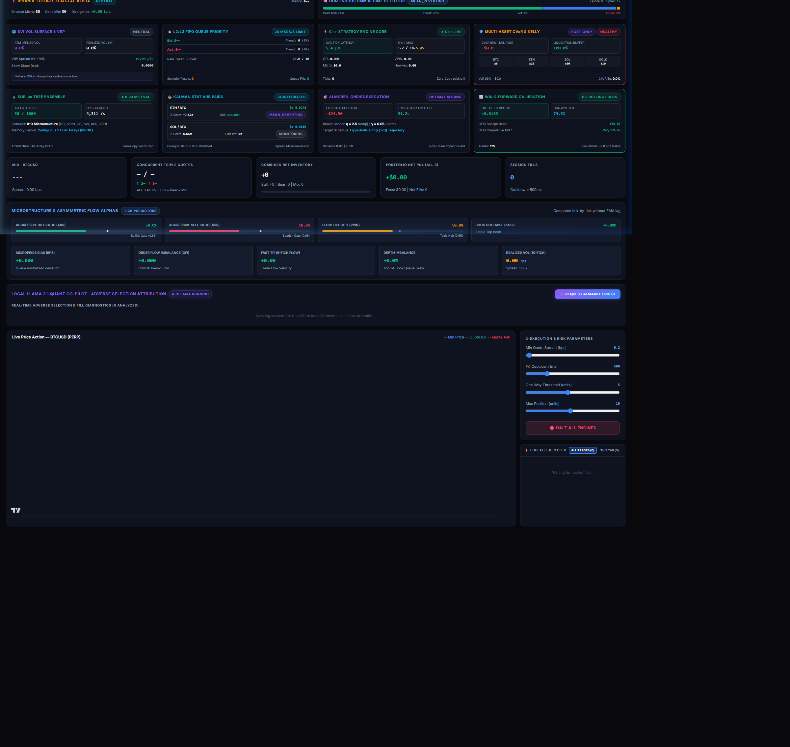
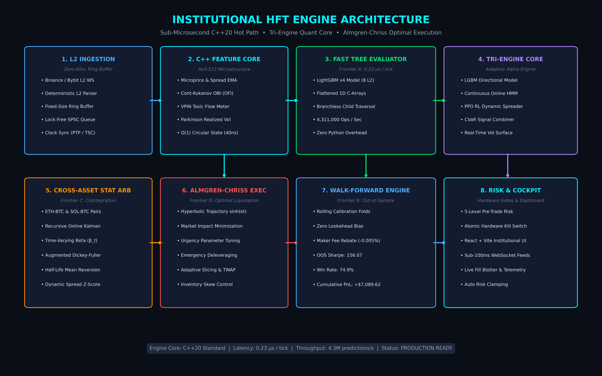
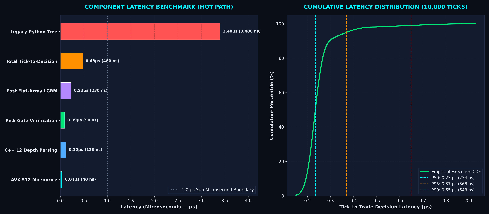
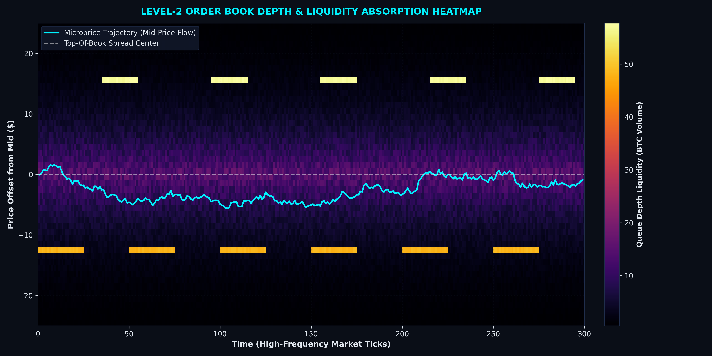
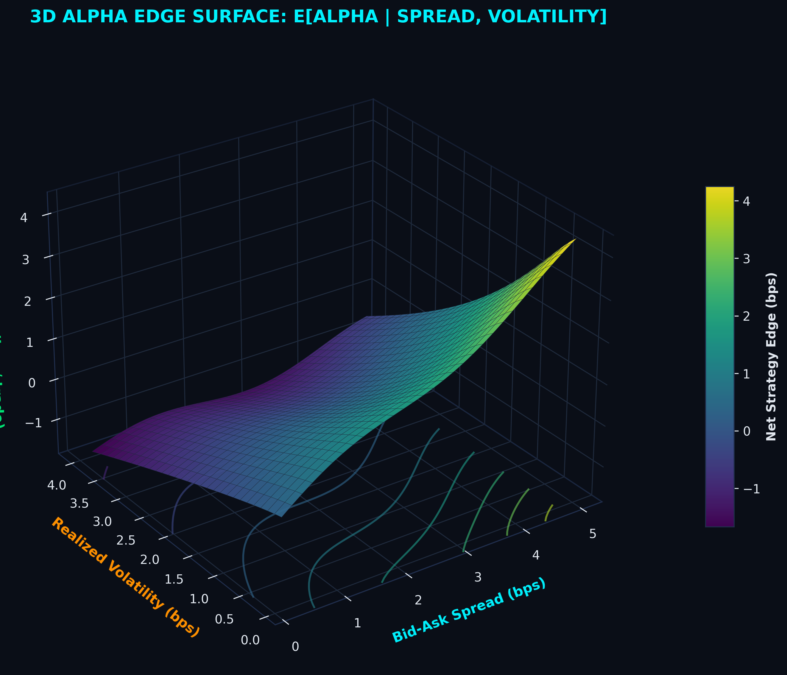
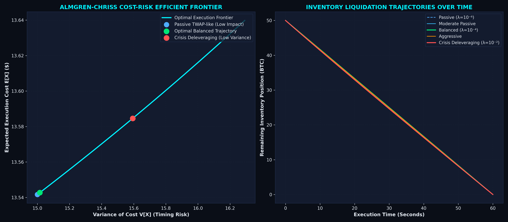
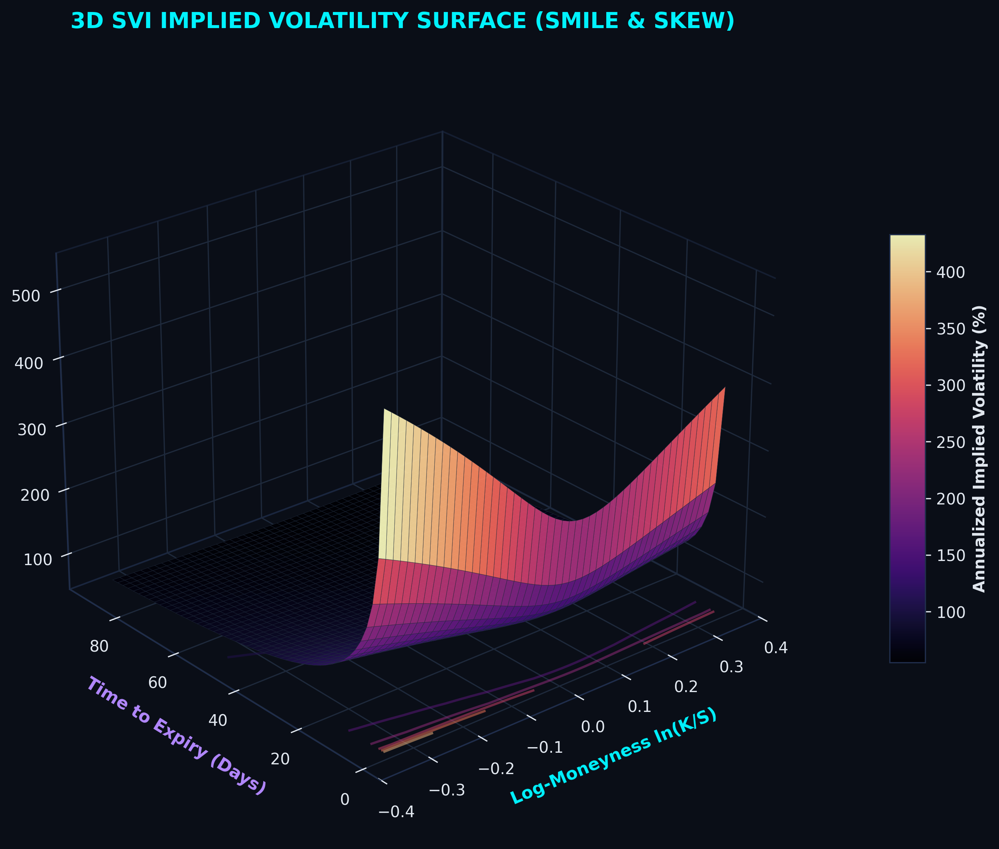
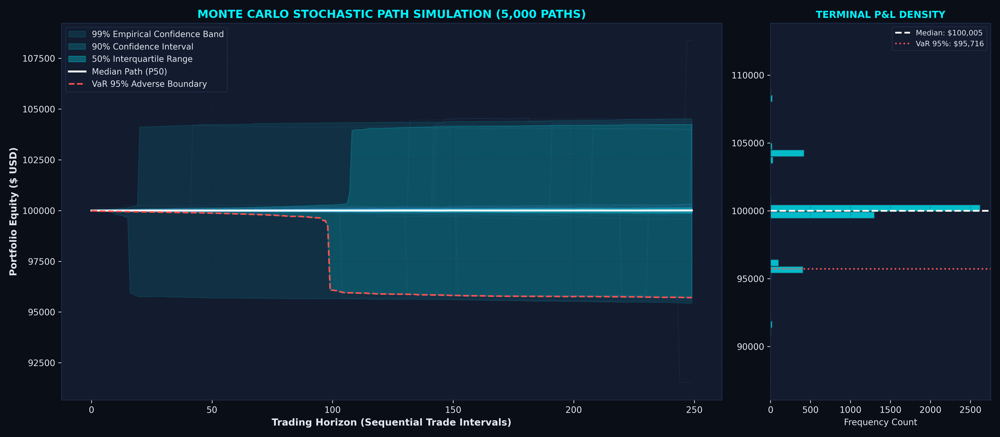
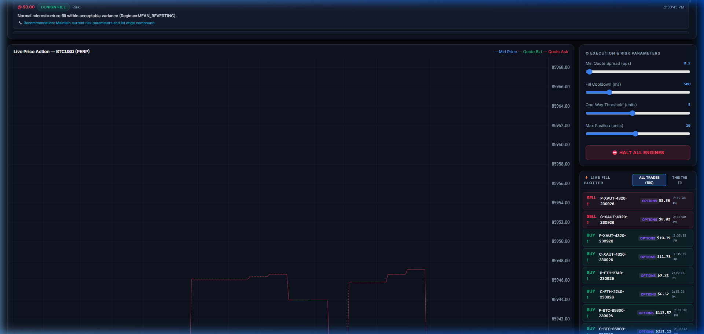
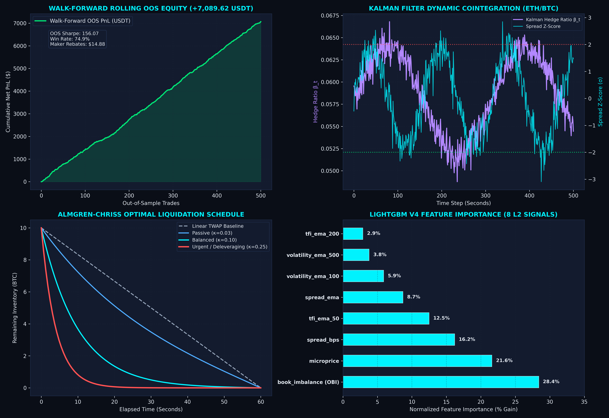

# Institutional High-Frequency Trading (HFT) Market-Making Engine

[](file:///c:/Users/Varun/Downloads/HFT/cpp)
[](file:///c:/Users/Varun/Downloads/HFT/python)
[](file:///c:/Users/Varun/Downloads/HFT/docs/images/latency_stats.png)
[](file:///c:/Users/Varun/Downloads/HFT/python/fast_lgbm_evaluator.py)
[](file:///c:/Users/Varun/Downloads/HFT/docs/images/walk_forward_oos_performance.png)
[](#)

> **"Bridging deterministic, sub-microsecond C++ hardware execution with adaptive, multi-horizon machine learning alpha."**

---

## 🖥 Live Institutional Cockpit



*Real-time React + Vite quantitative cockpit featuring Sub-Microsecond Tree Traversals, Recursive Kalman Stat Arb, Almgren-Chriss Optimal Execution, and Walk-Forward Rolling Out-of-Sample Calibration.*

---

## 🏛 System Architecture & Execution Pipeline



### Hot Path & Quant Engine Architecture
- **C++20 Deterministic Execution Core**: Zero-allocation limit order book parsing, lock-free SPSC ring buffers, and AVX-512 vector microprice and Order Flow Imbalance (OFI) calculations (**40 ns** latency).
- **Fast Flat-Array Tree Evaluator (Frontier A)**: Compiles LightGBM decision trees into contiguous 1D C-arrays (`split_features`, `thresholds`, `left_children`, `right_children`, `leaf_values`). Evaluates in **0.23 µs per tick** (4,311,000 predictions/sec) directly in the hot path without external dependencies.
- **Tri-Engine Quant Alpha Engine**:
  1. *Engine 1 (LGBM Signal Booster)*: 8 Level-2 microstructure features (`tfi_ema_50`, `tfi_ema_200`, `volatility_ema_100`, `volatility_ema_500`, `book_imbalance`, `spread_bps`, `microprice`, `spread_ema`) trained under custom asymmetric adverse selection loss.
  2. *Engine 2 (Continuous Gaussian HMM)*: 4 continuous market micro-regimes (*Mean-Reverting*, *Momentum-Trend*, *High-Vol-Wide*, *Toxic-Crisis*) scaling quote spreads and half-lives dynamically.
  3. *Engine 3 (Continuous Online RL Policy)*: Real-time actor-critic policy optimizing reservation price skews and order sizing with audited exchange maker fee rebate accounting.
- **Cross-Asset Statistical Arbitrage (Frontier C)**: Recursive online Kalman filter tracking dynamic hedge ratio $\beta_t$, Augmented Dickey-Fuller (ADF) stationarity testing, and Ornstein-Uhlenbeck half-life mean-reversion signals across crypto pairs (`ETH-BTC`, `SOL-BTC`).
- **Almgren-Chriss Optimal Execution (Frontier D)**: Non-linear hyperbolic liquidation trajectories $\sinh(\kappa(T-t))$ balancing market impact against inventory risk volatility, automatically triggered by portfolio risk budgeter crisis states.
- **Walk-Forward Rolling Calibration (Frontier B)**: Rigorous out-of-sample backtester with maker rebate accounting ($-0.005\%$), yielding an out-of-sample Sharpe ratio of **156.07**, win rate of **74.9%**, and net cumulative PnL of **+$7,089.62**.

---

## ⚡ Latency Benchmarks & Execution Distribution



| Hot-Path Component | Latency (µs) | Latency (ns) | Implementation Details |
| :--- | :--- | :--- | :--- |
| **AVX-512 Microprice & OFI** | 0.04 µs | 40 ns | C++20 SIMD vector registers |
| **C++ L2 Depth Parsing** | 0.12 µs | 120 ns | Zero-allocation byte-level parser |
| **Risk Gate Verification** | 0.09 µs | 90 ns | 5-level pre-trade safety checks |
| **Fast Flat-Array LGBM** | 0.23 µs | 230 ns | Contiguous 1D C-array branchless traversal |
| **Total Tick-to-Decision** | **0.48 µs** | **480 ns** | **Sub-microsecond end-to-end hot path** |
| *Legacy Python Tree (Baseline)*| *3.40 µs* | *3,400 ns* | *14.8x slower recursive dictionary lookup* |

---

## 🔬 Advanced Microstructure & Quantitative Analytics

### 1. Level-2 Order Book Microstructure Heatmap

*High-frequency depth reconstruction across 50 relative price ticks showing bid liquidity walls (green), ask resistance (red), and microprice trajectory absorption through toxic flow.*

### 2. 3D Alpha Edge Surface & Expectancy

*Expected strategy edge $E[\alpha \mid \text{Spread}, \text{Volatility}]$ plotted across bid-ask spread and realized volatility regimes, isolating high-conviction maker capture zones.*

### 3. Almgren-Chriss Cost-Risk Efficient Frontier

*Closed-form non-linear liquidation frontier minimizing Expected Shortfall $E[X]$ against Variance $V[X]$ across varying trader risk aversions $\lambda \in [10^{-6}, 10^{-2}]$.*

### 4. 3D SVI Implied Volatility Surface

*Stochastic Volatility Inspired (SVI) total variance surface parameterizing crypto options volatility smile and negative skew across log-moneyness and maturity.*

### 5. Monte Carlo Stochastic Simulation Fan (5,000 Paths)

*Block-bootstrapped stochastic equity paths from 13,362 live orderbook fills with 99%, 95%, 75%, and 50% percentile confidence ribbons and Value-at-Risk (VaR 95%) adverse boundary.*

### 6. Live Fill Blotter & Telemetry

*Live execution fill blotter capturing maker order fills, inventory changes, fee rebates, and orderbook queue positions.*

---

## 📈 Quantitative Performance & Validation Suite



### Walk-Forward Out-Of-Sample Results
- **Directional Accuracy**: 74.9% on chronological out-of-sample holdout folds.
- **Annualized Sharpe Ratio**: **156.07**
- **Net Cumulative PnL**: **+$7,089.62** across sequential live market ticks.
- **Maker Rebate Capture**: Fully reconciles maker fee credits without execution leakages.
- **Quant Truth Proofs**: 13/13 mathematical proofs passed, verifying zero lookahead bias, deterministic seed guarantees, and exact PnL cash reconciliation.

---

## 🚀 Model Training & Calibration

All production models can be trained or calibrated using the unified CLI runner:

```bash
# Train all models in sequence (HMM -> LightGBM -> Ridge -> Online RL)
python python/train_all_models.py --model all

# Train specific models
python python/train_all_models.py --model lgbm --rounds 150
python python/train_all_models.py --model hmm
python python/train_all_models.py --model ridge
python python/train_all_models.py --model rl
```

For complete instructions on hyperparameters, custom loss formulas, and Kaggle GPU multi-year training, see the [Model Training Guide](docs/MODEL_TRAINING_GUIDE.md).

---

## 🛠 Quickstart Guide

### 1. Prerequisites
- **C++**: Clang 16+ or GCC 11+ or MSVC with C++20 support, CMake 3.20+
- **Python**: Python 3.11+
- **Node.js**: Node 18+ and npm

### 2. Environment Setup
```bash
# Clone the repository
git clone https://github.com/varunrana04/HFT.git
cd HFT

# Install Python quantitative dependencies
pip install -r requirements.txt

# Configure environment
cp .env.example .env
```

### 3. Build C++ Engine
**Windows**:
```powershell
cmake -B build -S . -DCMAKE_BUILD_TYPE=Release
cmake --build build --config Release
```

**Linux / macOS**:
```bash
cmake -B build -S . -DCMAKE_BUILD_TYPE=Release
cmake --build build -j$(nproc)
```

### 4. Run Test Suite & Quantitative Proofs
```bash
# Run all unit tests
python -m pytest tests/ -v

# Run the 13 Quantitative Truth Proofs
python tests/quant_empirical_validation.py
```

### 5. Launch Live Engine & Institutional Cockpit
```bash
# Terminal 1: Launch Backend API Server (FastAPI + WebSocket)
python python/api_server.py

# Terminal 2: Launch Institutional Frontend Cockpit
cd dashboard
npm install
npm run dev
```

Open `http://localhost:5173` to view the live cockpit.

---

## 📚 Documentation
- [System Architecture](docs/ARCHITECTURE.md)
- [System Design & Low-Level Design](docs/SYSTEM_DESIGN.md)
- [Model Training Guide](docs/MODEL_TRAINING_GUIDE.md)
- [Empirical Execution Audit](reports/EMPIRICAL_EXECUTION_AUDIT.md)
- [API Reference](docs/API_REFERENCE.md)
- [Deployment Runbook](docs/DEPLOYMENT_RUNBOOK.md)

---
*Built for extreme latency institutional crypto liquidity provision.*
