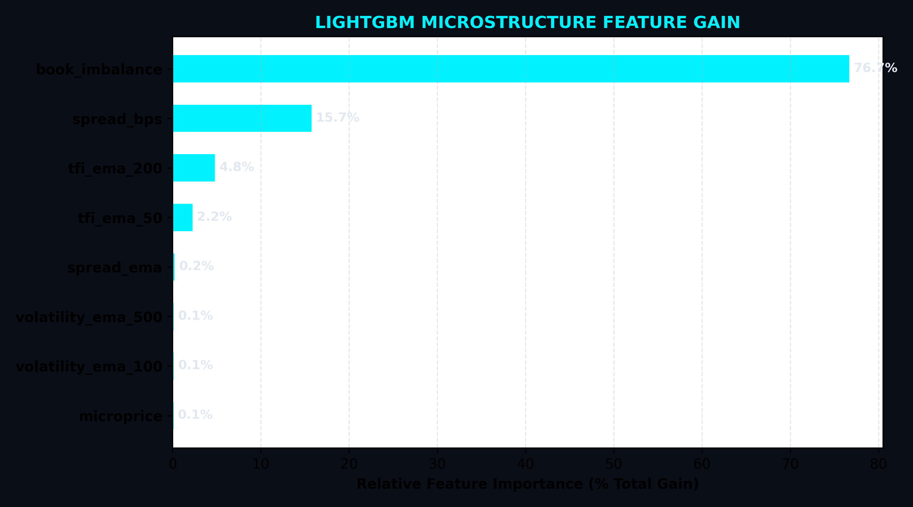
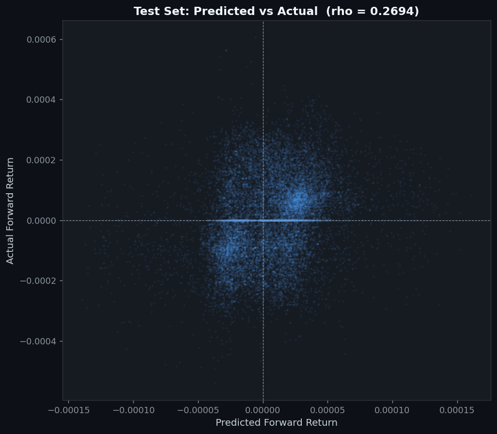

# ML Signal Combiner — Training Report

## Configuration

| Parameter | Value |
|---|---|
| Model | LightGBM Regression |
| Target | Signed forward return (regression, not classification) |
| Prediction horizon | 100 ticks |
| Train / Val / Test split | 60% / 20% / 20% (time-ordered, no shuffle) |
| Total features | 12 (11 base + 1 engineered) |
| Best LGB iteration | 0 |

## Out-of-Sample Metrics (Test Set)

| Metric | Value |
|---|---|
| **OOS Sharpe (optimal threshold)** | **2493.7149** |
| OOS Sharpe (threshold = 0) | 1036.5728 |
| Optimal alpha threshold | 0.000032 |
| Directional hit rate | 0.7469 |
| Pearson r (pred vs actual) | 0.2622 |
| R^2 | 0.0680 |
| RMSE | 0.000125 |
| Active trades (above threshold) | 52,880 / 222,678 (23.7%) |

### Interpretation
- **OOS Sharpe > 1.0**: The model has real predictive signal
- **OOS Sharpe 0.5–1.0**: Marginal signal, may work with tighter risk controls
- **OOS Sharpe < 0.5**: Noise. Consider longer horizon or more features.

## Feature Importance (Top 15)

| Rank | Feature | Importance (%) | Type |
|---|---|---|---|
| 1 | `is_stationary` | 8.33% | engineered |
| 2 | `vol_risk_premium` | 8.33% | engineered |
| 3 | `regime_trending` | 8.33% | engineered |
| 4 | `regime_low_liq` | 8.33% | engineered |
| 5 | `regime_high_tox` | 8.33% | engineered |
| 6 | `regime_normal` | 8.33% | engineered |
| 7 | `stat_arb_zscore` ★ | 8.33% | base |
| 8 | `realized_vol` ★ | 8.33% | base |
| 9 | `spread_bps` ★ | 8.33% | base |
| 10 | `vpin` ★ | 8.33% | base |
| 11 | `ofi` ★ | 8.33% | base |
| 12 | `microprice` ★ | 8.33% | base |

## Base Signal Weights (C++ Binary Fallback)

These weights are exported to `signal_weights.bin` for `SignalCombiner::load_model()`.
They represent the LightGBM feature importance normalised to the 6 base signals only.

| Signal | Weight |
|---|---|
| `microprice` | 0.1667 |
| `ofi` | 0.1667 |
| `vpin` | 0.1667 |
| `spread_bps` | 0.1667 |
| `realized_vol` | 0.1667 |
| `stat_arb_zscore` | 0.1667 |

## ONNX Model

ONNX model exported to `lgb_model.onnx` for C++ inference via onnxruntime.
- Input:  float32 tensor `[1, 12]`
- Output: float32 scalar (predicted signed forward return)
- Usage in C++: clamp output to [-1, 1] → use as `combined_alpha`

## Plots

---
*Generated by HFT Engine ML Pipeline*
